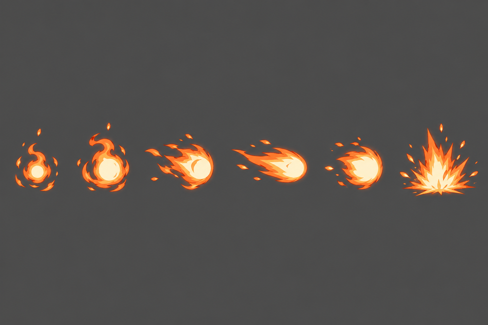
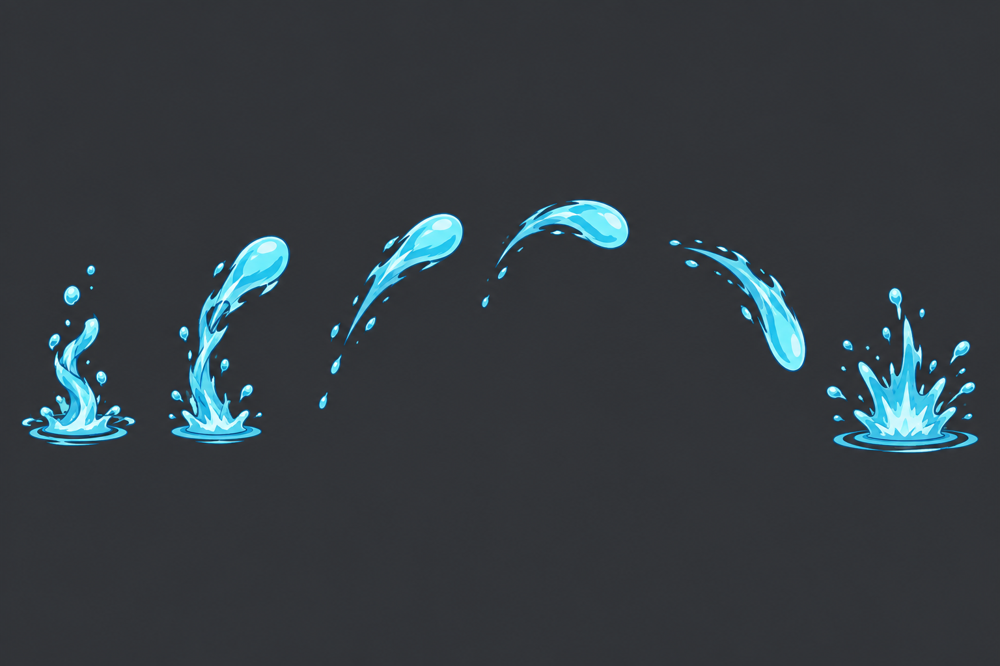
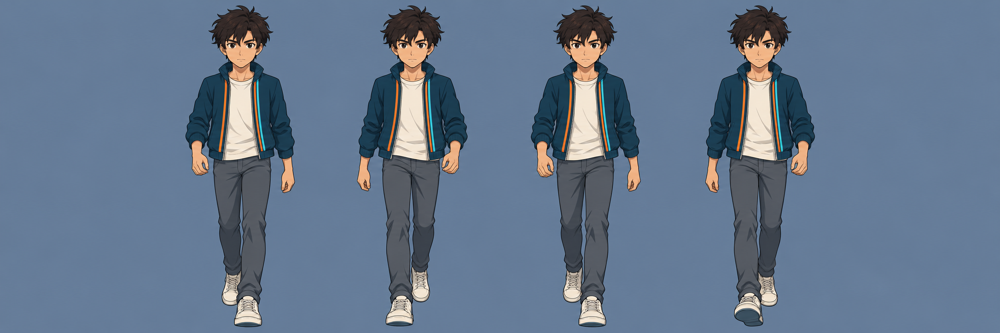
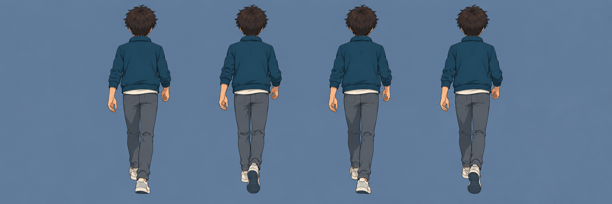
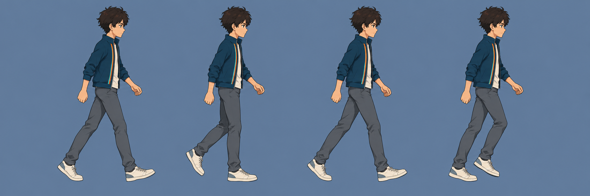
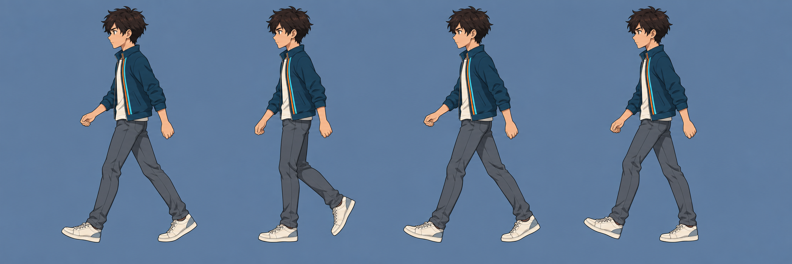
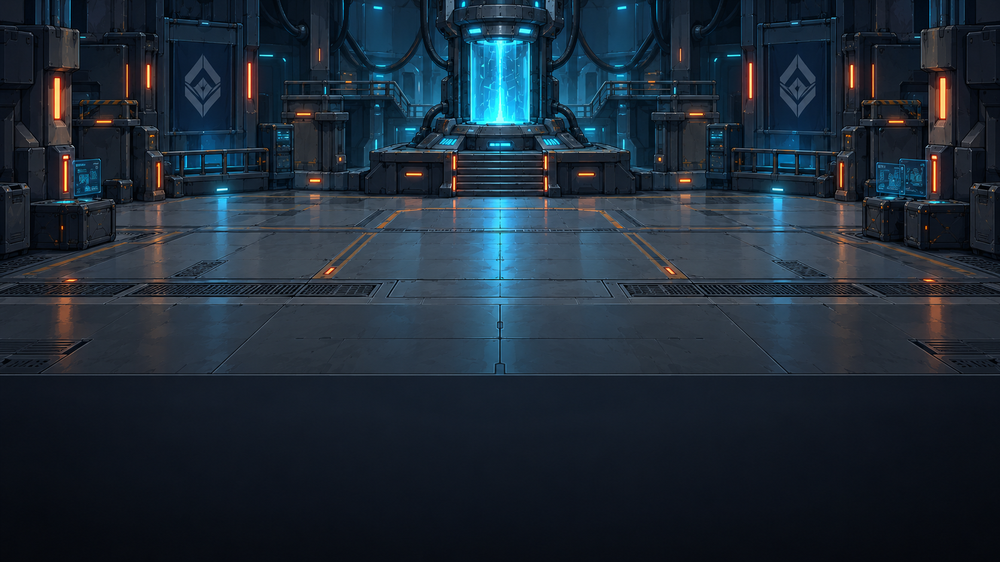
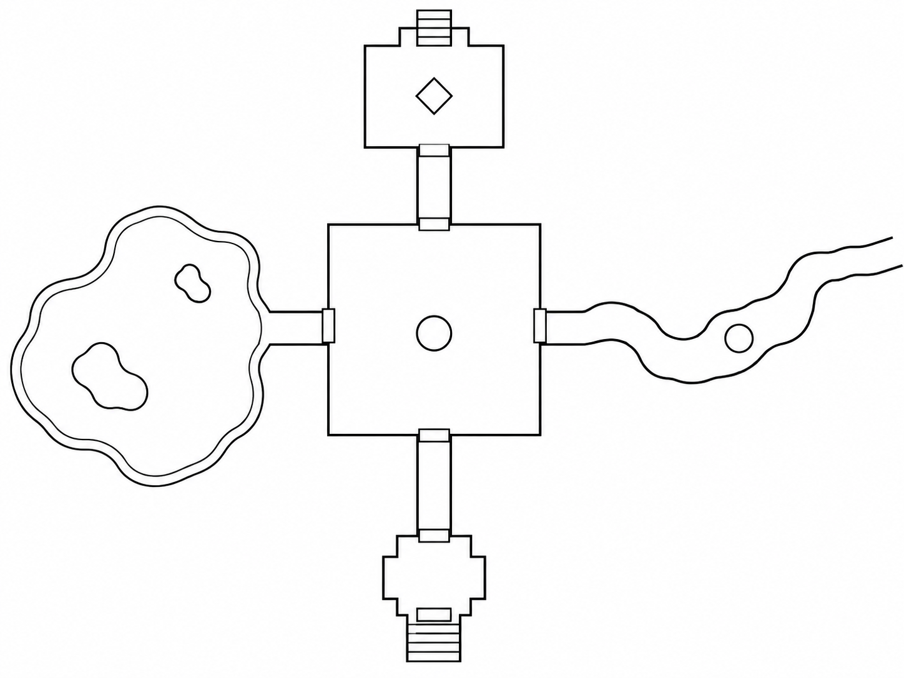
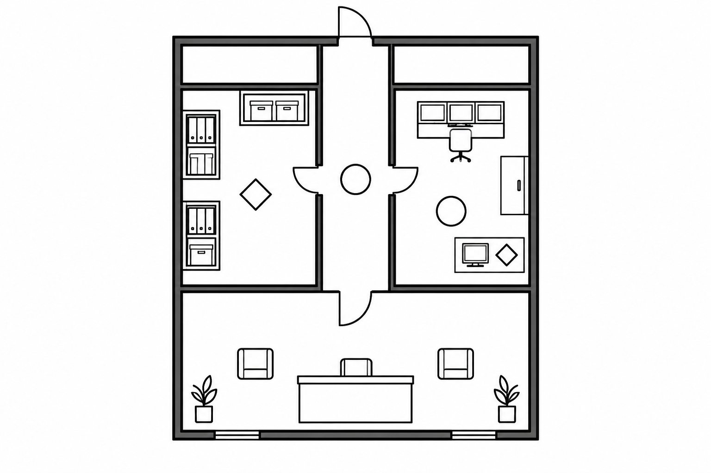
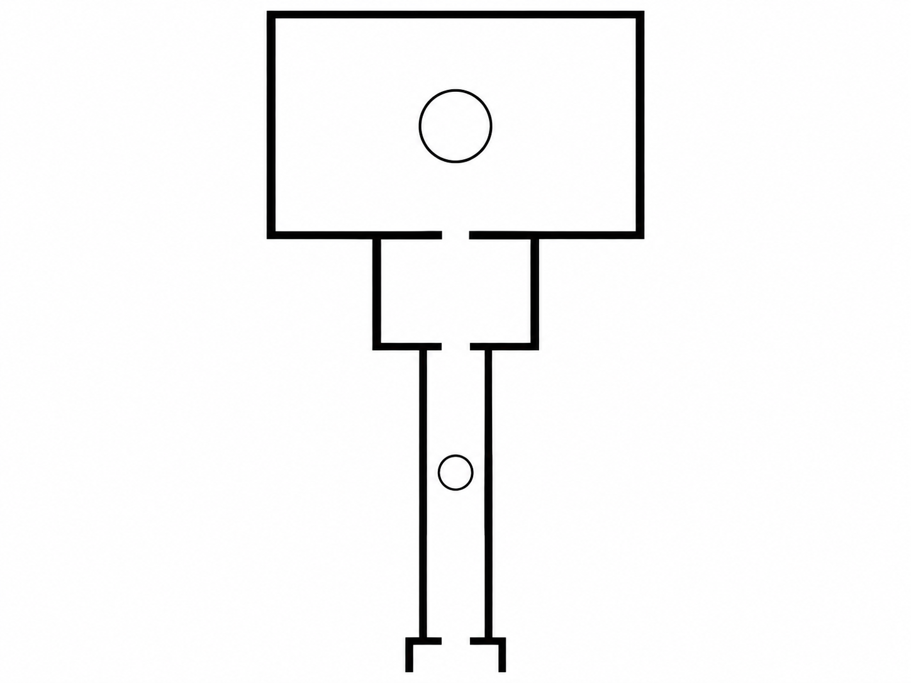

# Between fire and water

## GDD v0.2 | Direção Visual e Level Design | 10/09/2026

## Concepção do jogo

### Identificação

Nome provisório: Between fire and water. Gênero: RPG 2D por turnos, para um jogador. Tecnologia prevista: Unity e C#. Público-alvo: pessoas a partir de 13 anos interessadas em fantasia, investigação e evolução de personagem. Plataformas-alvo: PC e mobile; Windows e Android são a proposta inicial de sistemas.

### Entrega e versão

Entrega 2 - Direção Visual e Level Design. Data: 10/09/2026. Valor: 1,0 ponto. Versão: v0.2. Atualiza o GDD v0.1 com as dez imagens fornecidas, direção de arte, planejamento de sprites, cenários, fases e desafios. Documento de pré-produção; ainda não há build ou projeto Unity.

### High Concept

Um jovem capaz de controlar fogo e água descobre que a agência que prometeu protegê-lo quer eliminá-lo. Em um RPG 2D por turnos baseado em Entre fogo e água, o jogador acompanha Magnus Lubros, investiga pistas sobre a ASDA, domina habilidades elementais e fortalece-se em batalhas até enfrentar a organização e descobrir quem realmente cumpre a profecia.

### Objetivo do jogador

Concluir o modo história: investigar a ameaça, superar os confrontos obrigatórios e chegar ao desfecho da queda da ASDA. A evolução por experiência permite enfrentar desafios progressivamente mais fortes.

### Pilares da experiência

Combate acessível: decisões claras em turnos. Descoberta: examinar o mapa revela pistas e desbloqueia objetivos. Progressão: vencer confrontos concede XP e aumenta o poder de Magnus. Narrativa: a campanha mantém o conflito e a revelação central do livro.

### Status das decisões

Nome, gênero, integrantes, público, plataformas, objetivo, combate, exploração e progressão foram informados pelo grupo. Divisão de papéis, quantidade de conteúdo, controles e regras numéricas deste GDD são propostas iniciais a validar e ajustar durante o desenvolvimento.

## Equipe e produção

### Larissa Campos Cardoso

Proposta de responsabilidade principal: Game Designer + Producer. Organizar conceito, roteiro adaptado, GDD, escopo, cronograma e acompanhamento das entregas. Apoiar testes de compreensão da história e dos objetivos.

### Izak Pinheiro

Proposta de responsabilidade principal: Artista 2D + Animador. Produzir concepts, model sheets, sprites, cenários, interface e animações. Acumular Level Design + Sound Design: planejar os três mapas e selecionar, produzir ou editar os efeitos e a trilha.

### Matheus Henrique

Proposta de responsabilidade principal: Programador + QA. Implementar exploração, combate, XP, interface, salvamento e integração na Unity. Gerar builds, registrar bugs e verificar controles, progressão e estabilidade em PC e mobile.

### Trabalho compartilhado

A equipe tem três integrantes; a divisão acima acumula áreas para cobrir a produção. Todos participam de playtests e revisões. A atribuição nominal ainda depende da validação do grupo e não comprova contribuições já realizadas. Cada integrante deverá registrar suas contribuições reais no histórico do projeto.

### Fluxo de trabalho proposto

Manter um único repositório com documentos, código e materiais produzidos. Usar tarefas pequenas com responsável e critério de conclusão. Atualizar o GDD quando houver mudança de regra ou escopo. Realizar uma revisão da versão antes de cada entrega e marcar a revisão correspondente com uma tag.

### Cronograma da disciplina

03/09 - v0.1: concepção e GDD inicial (entrega pendente). 10/09 - v0.2: direção visual e planejamento de fases. 17/09 - v0.3: protótipo jogável. 24/09 - v0.4: vertical slice com sistemas integrados. 01/10 - v0.5: conteúdo completo, playtesting e correções. 08/10 - v1.0: build final, GDD final e apresentação.

### Prioridades imediatas

Validar a direção visual e as responsabilidades; preparar recorte e padronização dos sprites; implementar na v0.3 o movimento, uma pista e uma batalha. Os mapas e parâmetros desta versão são propostas para validação no protótipo.

## História e adaptação

### Referência principal

Base desta revisão: Between-fire-and-water-GDD-v0.1.pdf, seis páginas, preservado em output/pdf. O GDD anterior identifica o manuscrito Entre fogo e água, 21 páginas, como fonte narrativa. As referências de páginas do livro abaixo são herdadas da v0.1; o manuscrito não foi consultado novamente nesta revisão. Autoria e edição continuam pendentes.

### Mundo e conflito - páginas 1 a 6

O prólogo apresenta uma profecia sobre alguém ligado ao fogo e à água e uma organização criada para impedir sua realização. Na trama contemporânea, Magnus Lubros, de 14 anos, possui ligação com as duas nações. Ele e Lizzie entram em contato com a ASDA, que se apresenta como uma agência de proteção.

### Treinamento e traição - páginas 7 a 16

Magnus treina com Ki e aprende a controlar seus poderes. A confiança nos responsáveis pelo acampamento se desfaz quando a intenção de eliminá-lo é revelada. Ele foge, é capturado e escapa novamente com Lizzie, que também demonstra poderes.

### Aliados e investigação - páginas 16 a 19

Magnus e Lizzie encontram Michael, Olive e Brian. O grupo investiga a ASDA e identifica a ligação da empresa DASA com a organização. Esses acontecimentos fundamentam os objetivos de investigação e a progressão até a base inimiga.

### Desfecho - páginas 20 e 21 | spoilers

No confronto final, Brian se sacrifica e cria a oportunidade para os amigos reagirem e destruírem a ASDA. A revelação é que Brian, e não Magnus, cumpre a profecia em seu aniversário de 18 anos. O epílogo mostra os sobreviventes procurados após a destruição da empresa.

### Recorte para o jogo

Proposta: condensar a campanha em treinamento, investigação e confronto final. O prólogo e as viagens serão apresentados em diálogos curtos. Magnus será o único personagem controlável; Lizzie, Michael, Olive e Brian participarão por diálogos e eventos. Mark será adaptado como chefe final. O combate vencido conduz ao desfecho narrativo inspirado no livro, preservando a revelação sobre Brian.

### Tom e consistência

Adotar aventura e tensão com violência estilizada, sem gore e sem conteúdo sexual. Romance apenas sugerido. A faixa 13+ é uma intenção de público, não uma classificação oficial. Padronizar no roteiro os nomes usados de forma inconsistente no manuscrito e a idade de Brian conforme a revelação final. Usar áudio original ou com licença adequada; músicas citadas no livro não integram o escopo sonoro automaticamente.

## Mecânicas e core loop

### Mecânica principal: batalhas em turnos

Proposta inicial: Magnus enfrenta um inimigo por encontro. O jogador escolhe uma ação por turno: ataque básico, habilidade de fogo, habilidade de água ou defesa. Após a ação e a verificação de vida, o inimigo age se estiver vivo. A sequência se repete até a vitória ou derrota. Menus de ação pausam a decisão, sem limite de tempo.

### Fogo, água e defesa

O ataque básico não consome energia. A habilidade de fogo causa dano maior; a de água causa dano moderado e reduz o próximo dano recebido; defender reduz o próximo dano e recupera energia. Cada efeito defensivo expira após o próximo ataque recebido e não acumula. Valores, custos e multiplicadores serão definidos no protótipo. A interface deve mostrar custos, vida, energia e efeitos ativos.

### Mecânica secundária: investigação de mapa

Explorar mapas 2D com visão superior, conversar com NPCs e examinar objetos destacados. Pistas obrigatórias atualizam o objetivo e liberam a próxima área. Pistas opcionais acrescentam contexto. A aproximação de um inimigo visível inicia o combate; encontros obrigatórios vencidos não reaparecem.

### Experiência e evolução

Derrotar inimigos concede XP uma única vez por encontro. Atingir os limiares de XP aumenta o nível e melhora vida e poder de ataque. Proposta de limite: três níveis na campanha curta. O total de XP dos encontros obrigatórios deve permitir concluir o jogo sem repetir batalhas. Não haverá perda de nível após derrota.

### Core loop

Explorar o mapa > investigar pistas e identificar o objetivo > enfrentar e derrotar inimigos > receber XP > subir de nível e ficar mais forte > desbloquear a próxima etapa da história > explorar a nova área. O ciclo termina ao concluir o confronto final e o epílogo.

### Vitória e derrota

Na batalha, vence quem reduzir primeiro a vida do oponente a zero. A vida é limitada a zero no mínimo e a resolução interrompe as ações seguintes; não há ações simultâneas nesta proposta. Se Magnus chegar a zero, mostrar derrota e permitir reiniciar o encontro no estado anterior, sem duplicar XP. A vitória da campanha exige terminar os objetivos obrigatórios, vencer o chefe e assistir ao desfecho.

### Sistemas de apoio

Prever pausa, volume, retorno ao menu e um salvamento automático local ao concluir cada área. Ao carregar, restaurar nível, XP e objetivos concluídos. A cena narrativa de sacrifício de Brian não será tratada como derrota do jogador.

## Escopo inicial e experiência

### Campanha proposta

Duração estimada: 20 a 30 minutos, a confirmar em playtest. Três mapas pequenos, seis encontros no total e um único final. Uma campanha linear completa com começo, desenvolvimento e conclusão, condensando o livro para o prazo disponível.

### Mapa 1 - Acampamento e templo

Apresentar Magnus, Lizzie, Ki e o treinamento. Ensinar movimento, interação, ataque e defesa com um encontro de treino. A descoberta da traição abre uma rota de fuga com um guarda. Saída: alcançar o ponto de fuga após cumprir os objetivos. Total: dois encontros.

### Mapa 2 - Posto DASA

Apresentar os aliados por diálogos e investigar o vínculo da empresa com a ASDA. Encontrar duas pistas obrigatórias: identificação da organização e registro da base. Enfrentar dois guardas e liberar o caminho para o confronto final. Total: dois encontros.

### Mapa 3 - Base ASDA

Percorrer uma área curta até Mark. Vencer um guarda de elite e o chefe final; apresentar o sacrifício de Brian, a queda da ASDA e o epílogo em sequência narrativa. Total: dois encontros. O chefe é uma adaptação de gameplay, não uma descrição literal do combate do livro.

### Conteúdo e recursos previstos

Um personagem controlável; quatro aliados narrativos; Ki como instrutor e oponente de treino; Mark como antagonista. Reutilizar a base visual de guarda em variantes comum e elite. Prever sprites de exploração de Magnus, NPCs estáticos, retratos essenciais, poses de combate e efeitos simples de fogo e água. Animações mínimas: parado, andar, atacar, receber dano e derrota.

### Interface e controles

PC: WASD ou setas para mover, E para interagir, mouse para menus e Esc para pausar. Mobile: direcional virtual, botão de interação e seleção de ações por toque, em orientação horizontal. Prever menu inicial, objetivo atual, HUD de vida/energia/nível, menu de combate, vitória, derrota e créditos. Usar texto e ícones junto às cores de fogo e água.

### Limites de produção

Ficam fora da v1.0 proposta: mundo aberto, multiplayer, combate com equipe controlável, criação de itens, árvore extensa de habilidades, finais alternativos, dublagem e adaptação de todas as cenas do livro. PC e mobile continuam como alvos; validar Android cedo e priorizar a estabilização do PC. Se o prazo apertar, reduzir diálogos e variedade visual antes de remover história, investigação ou turnos.

## Direção visual e referências

### Identidade proposta

Fantasia contemporânea com personagem de traço ilustrado/anime, roupas cotidianas e poderes elementais. A ASDA usa arquitetura industrial, metal escuro, tubulações e luz ciano. A oposição entre fogo e água deve guiar efeitos e interface sem transformar o jogo em plataforma: permanece RPG de exploração superior e combate por turnos.

### Paleta de produção

Fogo: laranja #E17A3C e amarelo #FFD166. Água: ciano #259EBC e azul-claro #7BDFF2. Estruturas e interface: azul-escuro #152C3D e cinza #526878. Texto claro: #F4F1E8. São cores propostas para padronização, não uma extração exata dos pixels das imagens.

### Forma, leitura e câmera

Magnus deve manter silhueta reconhecível, cabelo castanho, jaqueta azul-petróleo, camiseta clara, calça cinza e tênis claros. Fogo usa pontas e expansão; água usa curvas e gotas. Exploração com câmera superior levemente inclinada; as vistas atuais do personagem precisam ser adaptadas a esse ângulo. Arena frontal reservada à cena de combate.

### Referências disponíveis

As dez imagens enviadas são o painel visual interno desta entrega: quatro pranchas de Magnus, dois efeitos elementais, uma arena e três plantas. Não foram atribuídos artistas, licenças ou jogos de referência sem fonte. A equipe deve confirmar autoria, ferramenta e permissão de uso antes dos créditos finais. Os nomes originais e hashes estão em imagens/inventario.json.

### Interface e acessibilidade

Fonte sem serifa, alto contraste, painéis escuros e textos claros. Ações identificadas por nome e ícone: chama, gota e escudo; não depender apenas da cor. Manter objetivo visível e indicação de interação. Proposta mobile: alvos de toque de pelo menos 48 unidades lógicas, a testar no aparelho escolhido.

## Concept art | fogo e água

### Aplicação

Fogo enfatiza impacto; água reforça fluxo e proteção. Fundo opaco e espaçamento devem ser corrigidos na produção. Cada prancha é referência de estágios do efeito.

## Magnus - model sheet de referência

### Prancha e proporções

As quatro vistas nas páginas seguintes formam o model sheet preliminar de Magnus. Cada tira apresenta quatro poses; serve para consultar frente, costas e os dois perfis e estudar a caminhada. Não é um turnaround neutro final: antes da produção, alinhar altura, linha dos pés, volume do cabelo, mangas e proporções entre vistas.

### Regras de consistência

Preservar cores da roupa, desenho da jaqueta e silhueta em todas as direções. Usar um único pivô nos pés. A altura da cabeça e o comprimento das pernas não devem oscilar entre frames. Expressão inicial determinada; dano e derrota precisam de poses próprias. A aparente idade deve respeitar Magnus, 14 anos, conforme a narrativa da v0.1.

### Status de produção

Disponível: referência visual do protagonista e poses de locomoção em quatro direções. A produzir: poses neutras alinhadas, ataque, conjuração, defesa, dano, derrota e expressões. Ki, aliados, guardas e Mark ainda precisam de concepts próprios; reutilizar a base de guarda para elite com insígnia e silhueta distinguíveis.

## Model sheet | frente e costas

### Uso

Consultar roupa, silhueta e proporções. As poses são de locomoção e exigem alinhamento antes do uso como sprites.

## Model sheet | perfis

### Uso

Conferir continuidade entre direita e esquerda. Não presumir simetria perfeita nem compatibilidade automática entre frames.

## Sprites e animações - plano técnico

### Formato proposto

Arte 2D ilustrada com transparência PNG/RGBA. Unidade inicial: tiles de 64 x 64 px, 64 pixels por unidade; personagem em célula de 128 x 192 px com pivô inferior central. Esses números são alvos de produção a validar em tela, não dimensões dos PNGs recebidos. Separar colisão dos pés do volume visual.

### Magnus na exploração

Idle: 1 pose por direção, 4 frames totais. Caminhada: 4 frames por direção, 16 no total, loop a 8 fps. As quatro tiras de 2172 x 724 px são referências para esses ciclos; recorte automático em quatro partes não garante pivôs nem margens consistentes. Preferir animação e recorte manual com alinhamento.

### Magnus no combate

Plano mínimo para uma orientação: ataque básico 4 frames/10 fps; fogo 4/10 fps; água 4/10 fps; defesa 2/6 fps; dano 2/8 fps; derrota 4/6 fps. Total adicional: 20 frames. Disparar dano/efeito em evento definido da animação; ações continuam regidas pelo turno. Não repetir automaticamente ataque ou derrota.

### Efeitos e demais personagens

Fogo: 6 frames alvo/12 fps; água: 6/12 fps, sem loop. Os concepts mostram estágios visuais, não uma sprite sheet pronta. NPCs narrativos: uma pose inicial para Lizzie, Michael, Olive e Brian. Ki, guarda, elite e Mark: idle, ataque, dano e derrota, com reutilização para reduzir trabalho. Validar antes de ampliar o inventário.

### Preparação e importação

Remover fundos opacos, normalizar escala e margens, corrigir inconsistências, exportar sem halo e manter originais conceituais. Na Unity, importar como Sprite, usar Multiple para atlas, pivô nos pés e filtro Bilinear para esta proposta ilustrada. Nome: magnus_walk_front_00.png; efeitos: fx_fire_00.png. Guardar assets finais e .meta juntos no futuro projeto Unity.

### Aceite visual

Testar ciclos sobre fundo claro e escuro: sem saltos de pivô, halos ou mudança de tamanho. Confirmar leitura em Windows e Android, custos das ações e contraste. As imagens atuais não comprovam animações implementadas nem integração na engine.

## Cenários - linguagem por fase

### Mapa 1: acampamento e templo

Exterior de terra e vegetação, pedra envelhecida no templo e acentos quentes no treino. Usar trilhas largas e marcos distintos para templo ao norte e fuga a leste. A planta existente define a composição espacial; pintura de cenário, tiles de chão, paredes, árvore, altar e saída ainda serão produzidos.

### Mapa 2: posto DASA

Recepção clara e salas administrativas frias com mesas, arquivos e terminais. Os objetos das duas pistas devem se destacar por ícone e interação, evitando que a leitura dependa de detalhes pequenos. A planta serve de conceito espacial; ainda faltam tiles e ilustração final.

### Mapa 3: base ASDA

Corredor de acesso estreito leva a uma arena ampla. A imagem do reator define metal escuro, luzes ciano e pontos quentes de alerta. O reator é ambientação proposta, não novo sistema de combate. O fundo frontal será usado na batalha; produzir tiles compatíveis com a exploração superior.

### Camadas e colisão

Separar piso, obstáculos, personagens e elementos acima do jogador. Paredes e máquinas bloqueiam; luz, fumaça e efeitos decorativos não bloqueiam. Corredores com pelo menos duas células livres e portas legíveis. Nada no cenário deve esconder pistas obrigatórias ou os controles de toque.

## Concept de cenário | arena ASDA

### Direção

Reservar espaço livre para Magnus, inimigo e menu de ações. A iluminação do reator reforça o foco central; o fundo não adiciona mecânicas. Produzir uma versão de exploração com a câmera superior prevista no GDD.

## Level design - regras de leitura

### Convenção das plantas

Nas plantas fornecidas, círculos serão pontos de encontro; losangos, objetos de investigação; portas e passagens representam conexões. A associação é uma decisão desta revisão. Os detalhes de cada página definem função e condição de acesso. Formas irregulares do mapa 1 são terreno e vegetação, não novos encontros.

### Escala e fluxo

Mapas esquemáticos, sem escala métrica original. Proposta para blockout: mapa 1 em 32 x 24 tiles, mapa 2 em 24 x 18 e mapa 3 em 20 x 28. Usar tiles de 64 px. Ajustar dimensões após testar movimento e câmera, mantendo a topologia e os seis encontros previstos.

### Sinalização e recuperação

Portas bloqueadas informam a condição faltante. Pista opcional nunca impede progresso. Derrota retorna ao estado anterior ao encontro; vitória marca o encontro como concluído e impede duplicar XP. Salvamento automático ao concluir cada mapa. Um objetivo textual orienta o próximo passo.

### Critérios de blockout

Percorrer entrada até saída com colisões; tentar sair antes de cumprir cada condição; visitar as salas do mapa 2 em ordens diferentes; reiniciar após derrota e recarregar após transição. Verificar que nenhuma pista fica inacessível e que não há encontros extras implícitos nos desenhos.

## Mapa 1 | acampamento e templo

### Rota principal

Entrada sul > pátio central (E1/Ki) > templo norte (losango: pista da traição) > retorno ao pátio > passagem leste (E2/guarda) > saída leste.

### Bloqueios e área opcional

Acesso à pista após E1; fuga liberada pela pista e vitória em E2. Área oeste funciona como espaço opcional de ambientação, sem combate ou XP. Saída ao norte do templo não é transição jogável nesta adaptação.

## Mapa 2 | posto DASA

### Rota principal

Entrada na recepção sul > corredor central (E3) > arquivo oeste (losango: identificação) e sala leste (E4; losango: registro da base) > porta norte para ASDA.

### Bloqueios e liberdade

Após E3, visitar oeste e leste em qualquer ordem. E4 protege a pista leste. Porta norte verifica E3, E4 e as duas pistas. Recepção serve de orientação e diálogo com aliados; não contém encontro extra.

## Mapa 3 | base ASDA

### Rota principal

Entrada sul > corredor (círculo: E5/elite) > antecâmara > arena norte (círculo: E6/Mark) > evento de Brian e epílogo.

### Bloqueios e conclusão

E5 libera a antecâmara; interagir com entrada da arena inicia diálogo e E6. Vitória encerra exploração e inicia o final. Não adicionar outra fase nem combate ao reator. Retentativa de E6 restaura estado pré-encontro sem repetir recompensa de E5.

## Progressão dos desafios

### Mapa 1 - aprender | 6 a 8 minutos

E1: Ki no pátio central ensina ataque e defesa com instruções visíveis. Após o treino, investigar o altar ao norte revela a traição. E2: guarda na passagem leste exige escolher entre dano de fogo e proteção de água. Vencer libera a fuga. Objetivo de aprendizagem: compreender exploração, interação e turno.

### Mapa 2 - aplicar | 7 a 10 minutos

E3: guarda no corredor protege acesso às salas. Investigar a identificação no arquivo oeste e o registro da base na sala leste. E4: guarda na sala leste testa gestão de energia; a pista dessa sala fica acessível após a vitória. A porta norte exige as duas pistas e ambos os encontros vencidos. Objetivo: combinar investigação e combate sem repetição de batalhas.

### Mapa 3 - dominar | 7 a 12 minutos

E5: elite no corredor prepara o uso de defesa contra ataque forte anunciado. E6: Mark na arena alterna ataque comum e preparação de ataque forte, com aviso textual. O jogador decide quando defender, recuperar energia ou usar fogo. Vitória inicia evento de Brian e epílogo. O sacrifício é narrativo, sem encontro adicional.

### XP proposta, a testar

Nível 1: 0 XP; nível 2: 40 XP acumulados; nível 3: 120 XP. Recompensas E1 a E6: 20, 20, 35, 45, 40 e 60 XP (220 ao final). Assim Magnus inicia mapa 2 no nível 2 e mapa 3 no nível 3; nenhum grind é necessário. Estes valores são novos parâmetros de planejamento, sem alegação de balanceamento testado.

### Escalada e limites

Aumentar primeiro a complexidade das decisões, depois a resistência dos inimigos. Números de dano, vida e energia serão definidos na v0.3. Medir duração, derrotas e compreensão dos avisos; se houver bloqueio, ajustar custos e dano antes de exigir XP adicional. Duração total estimada: 20 a 30 minutos.

## Validação e entrega v0.2

### Material incluído

GDD atualizado editável e em PDF; dez PNGs preservados e catalogados; model sheet preliminar em quatro vistas; concepts elementais e arena; identidade visual; planejamento de sprites, cenários, mapas e progressão. As páginas de plantas especificam rotas e bloqueios. A v0.1 permanece arquivada.

### Limites e próximos passos

Concluir concepts de NPCs e inimigos, finalizar turnaround neutro, produzir cenários dos mapas 1 e 2 e converter referências em sprites. Esses refinamentos ficam explicitamente pendentes; o material desta entrega é direção visual e planejamento, não assets finais nem protótipo.

### Validação v0.3 e final

V0.3: movimento com colisão, pista, batalha completa, XP único e reinício após derrota; verificar toque em Android. Final: concluir três mapas sem bloqueio, entender objetivos, salvar/retomar sem duplicar recompensas e concluir epílogo. Registrar plataforma, build, duração e resultado de cada teste. Ainda não há resultados de gameplay.

### Repositório

Remoto configurado: https://github.com/Matheus-Hen/entre-fogo-e-agua-2d. A tag v0.2 deve identificar o commit revisado desta entrega. A presença no remoto deve ser verificada após o envio; este texto não comprova publicação. README centraliza links e a matriz dos requisitos.

### Créditos e decisões pendentes

Confirmar autoria do manuscrito e procedência/licenças das imagens; validar papéis da equipe e parâmetros técnicos. As imagens foram fornecidas pelo usuário, sem metadados de autoria confirmados. Novas definições visuais e de level design neste documento são propostas coerentes com o GDD base.

### Histórico

v0.1 - 10/09/2026: concepção inicial relativa à etapa de 03/09. v0.2 - 10/09/2026: organização dos materiais, direção visual, model sheet de referência, planejamento de animação, cenários, rotas das três fases e progressão dos seis encontros.
