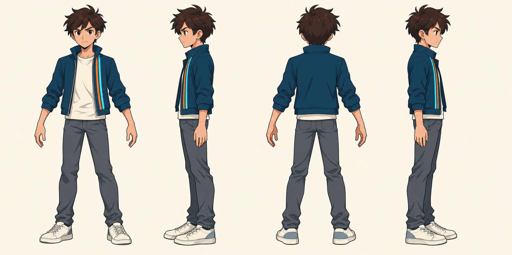
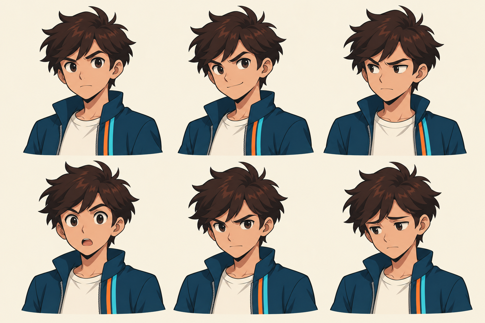
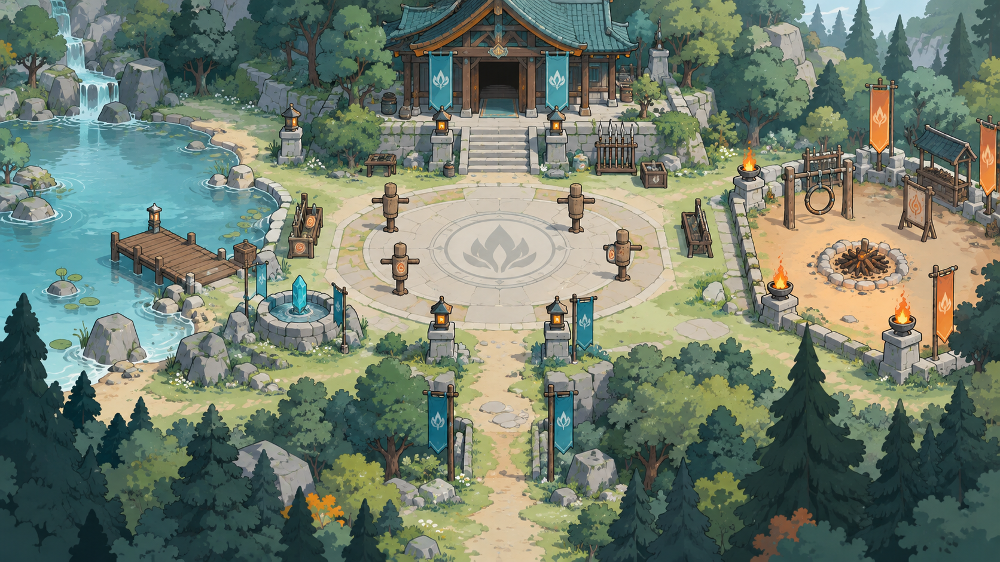
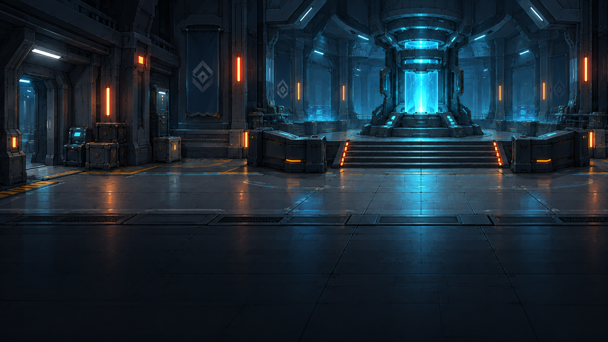
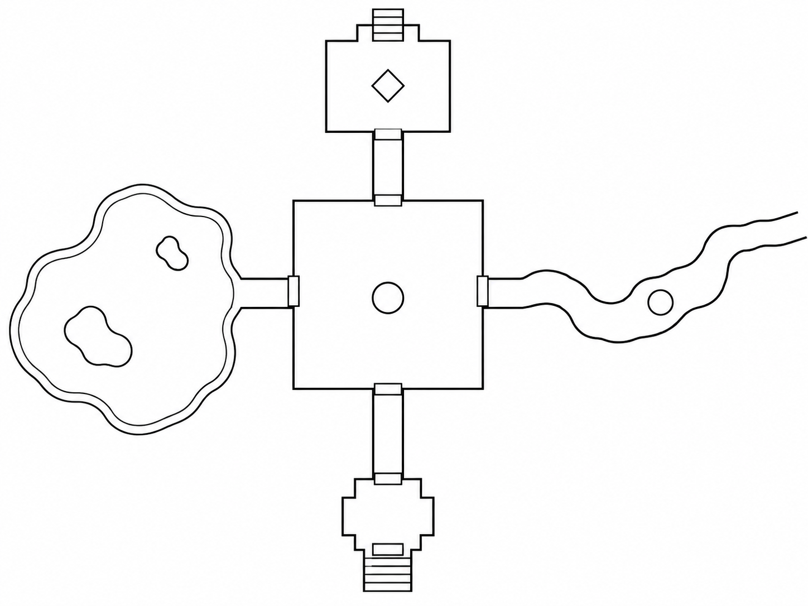
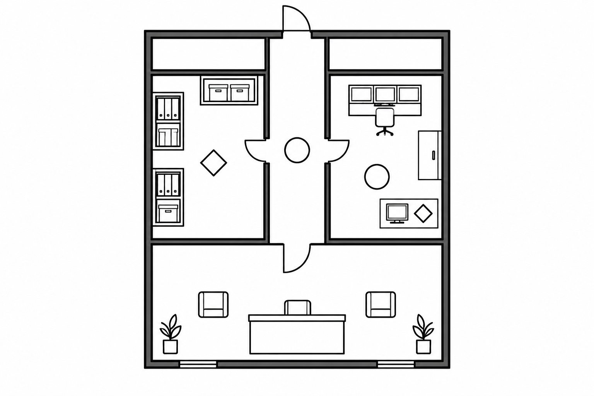
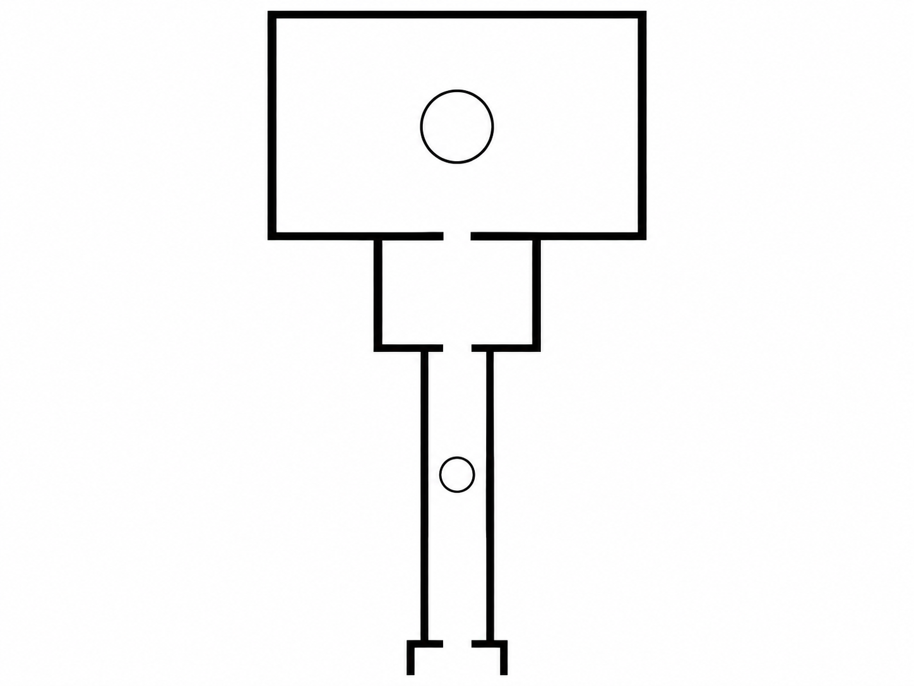
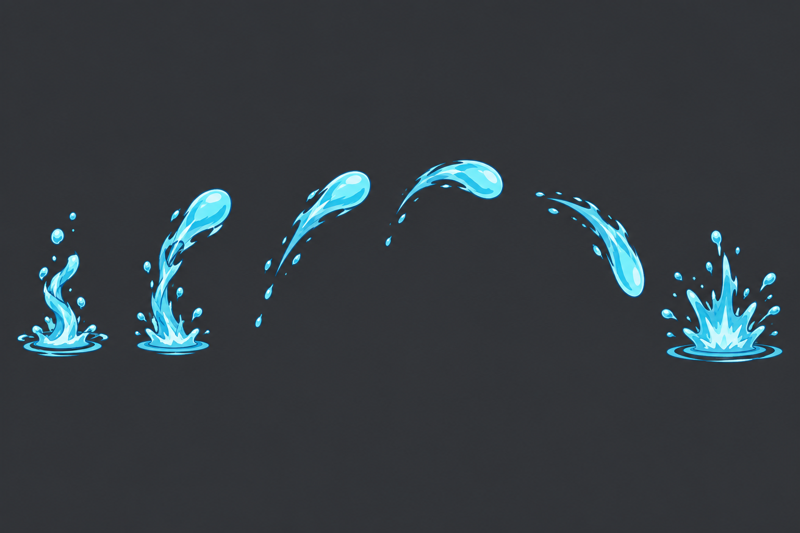

# Between fire and water | GDD consolidado

Documento canônico do projeto. Consolida a concepção, direção visual, acervo, planejamento e estado atual do protótipo. Atualizado em 08/10/2026.

## Concepção do jogo

### Identificação

Nome provisório: Between fire and water. Gênero: RPG 2D por turnos, para um jogador. Tecnologia prevista: Unity e C#. Público-alvo: pessoas a partir de 13 anos interessadas em fantasia, investigação e evolução de personagem. Plataformas-alvo: PC e mobile; Windows e Android são a proposta inicial de sistemas.

### Entrega e versão

Este documento reúne o GDD inicial, o planejamento visual e as revisões posteriores do projeto. O estado do protótipo foi atualizado em 08/10/2026; as versões v0.1, v0.2 e v0.2.1 permanecem como marcos históricos no Git, não como documentos ativos.

### Estado atual do projeto

O projeto Unity está em `Between fire and water/`. A cena `Assets/Scenes/SampleScene.unity` carrega a campanha implementada nos scripts do projeto. O protótipo inclui três fundos de exploração, limites de colisão nas fases, movimento por teclado ou toque, seis encontros, pistas, progressão, telas de menu/pausa/configurações, confirmações para substituir ou apagar saves, salvamento local e transições com fade. Mark alterna golpes comuns com ataques fortes anunciados. Esses fluxos ainda precisam de validação manual completa.

Em 08/10/2026, um teste automatizado de Play Mode passou. Ele verificou somente o carregamento dos três fundos de exploração, os quatro limites de colisão por mapa e a presença do corpo físico de Magnus. A compilação atual dos scripts passou sem erros. Testes ampliados para batalha, derrota, progressão entre fases e retomada do save foram adicionados em `Assets/Tests/PlayMode/`, mas ainda precisam ser executados no Unity. Nenhuma dessas verificações comprova teste em Android ou playtest externo. O relatório anterior está em `tmp/campaign-playmode-20261008-finalrun.xml`.

O projeto contém arte conceitual e estudos recebidos, mas nem todos são sprites finais. Os efeitos sonoros são sintetizados pelo protótipo; não há arquivos de áudio no acervo. A situação das versões Git deve ser consultada com `git tag`; o teste não cria uma tag de entrega.

### High Concept

Um jovem capaz de controlar fogo e água descobre que a agência que prometeu protegê-lo quer eliminá-lo. Em um RPG 2D por turnos baseado em Entre fogo e água, o jogador acompanha Magnus Lubros, investiga pistas sobre a ASDA, domina habilidades elementais e fortalece-se em batalhas até enfrentar a organização e descobrir quem realmente cumpre a profecia.

### Objetivo do jogador

Concluir o modo história: investigar a ameaça, superar os confrontos obrigatórios e chegar ao desfecho da queda da ASDA. A evolução por experiência permite enfrentar desafios progressivamente mais fortes.

### Pilares da experiência

Combate acessível: decisões claras em turnos. Descoberta: examinar o mapa revela pistas e desbloqueia objetivos. Progressão: vencer confrontos concede XP e aumenta o poder de Magnus. Narrativa: a campanha mantém o conflito e a revelação central do livro.

### Status das decisões

Nome, gênero, integrantes, público, plataformas e mecânicas básicas foram informados pelo grupo. O acervo visual foi fornecido pelo usuário e está organizado no repositório. Papéis, escopo, controles, regras e valores de produção continuam como propostas iniciais; recebimento de imagens não equivale à validação técnica ou aprovação final de todos os designs.

## Equipe e produção

### Larissa Campos Cardoso

Proposta de responsabilidade principal: Game Designer + Producer. Organizar conceito, roteiro adaptado, GDD, escopo, cronograma e acompanhamento das entregas. Apoiar testes de compreensão da história e dos objetivos.

### Izak Pinheiro

Proposta de responsabilidade principal: Artista 2D + Animador. Produzir concepts, model sheets, sprites, cenários, interface e animações. Acumular Level Design + Sound Design: planejar os três mapas e selecionar, produzir ou editar os efeitos e a trilha.

### Matheus Henrique

Proposta de responsabilidade principal: Programador + QA. Implementar exploração, combate, XP, interface, salvamento e integração na Unity. Gerar builds, registrar bugs e verificar controles, progressão e estabilidade em PC e mobile.

### Trabalho compartilhado

A equipe tem três integrantes; a divisão acima acumula áreas para cobrir a produção. Todos participam de playtests e revisões. A atribuição nominal ainda depende da validação do grupo e não comprova contribuições já realizadas. Cada integrante deverá registrar suas contribuições reais no histórico do projeto.

### Fluxo de trabalho proposto

Manter um único repositório com documentos, código e materiais produzidos. Usar tarefas pequenas com responsável e critério de conclusão. Atualizar o GDD quando houver mudança de regra ou escopo. Realizar uma revisão da versão antes de cada entrega e marcar a revisão correspondente com uma tag.

### Cronograma da disciplina

03/09 - v0.1: concepção e GDD inicial (entrega pendente). 10/09 - v0.2: direção visual e planejamento de fases. 17/09 - v0.3: protótipo jogável. 24/09 - v0.4: vertical slice com sistemas integrados. 01/10 - v0.5: conteúdo completo, playtesting e correções. 08/10 - v1.0: build final, GDD final e apresentação.

### Prioridades imediatas

Validar os papéis, revisar consistência das artes e preparar os sprites a partir das referências recebidas. Implementar na Unity exploração conectada a combate e verificar cedo os controles em Windows e Android. O guia de prompts v0.2 permanece como histórico de produção.

## História e adaptação

### Referência principal

Entre fogo e água, manuscrito fornecido pelo grupo em entre-fogo-e-agua.pdf, 21 páginas. Autoria e edição não foram informadas no pedido. As referências abaixo usam a numeração das páginas do arquivo PDF. O livro é fonte narrativa; as regras de jogo são propostas de adaptação.

### Mundo e conflito - páginas 1 a 6

O prólogo apresenta uma profecia sobre alguém ligado ao fogo e à água e uma organização criada para impedir sua realização. Na trama contemporânea, Magnus Lubros, de 14 anos, possui ligação com as duas nações. Ele e Lizzie entram em contato com a ASDA, que se apresenta como uma agência de proteção.

### Treinamento e traição - páginas 7 a 16

Magnus treina com Ki e aprende a controlar seus poderes. A confiança nos responsáveis pelo acampamento se desfaz quando a intenção de eliminá-lo é revelada. Ele foge, é capturado e escapa novamente com Lizzie, que também demonstra poderes.

### Aliados e investigação - páginas 16 a 19

Magnus e Lizzie encontram Michael, Olive e Brian. O grupo investiga a ASDA e identifica a ligação da empresa DASA com a organização. Esses acontecimentos fundamentam os objetivos de investigação e a progressão até a base inimiga.

### Desfecho - páginas 20 e 21 | spoilers

No confronto final, Brian se sacrifica e cria a oportunidade para os amigos reagirem e destruírem a ASDA. A revelação é que Brian, e não Magnus, cumpre a profecia em seu aniversário de 18 anos. O epílogo mostra os sobreviventes procurados após a destruição da empresa.

### Recorte para o jogo

Proposta: condensar a campanha em treinamento, investigação e confronto final. O prólogo e as viagens serão apresentados em diálogos curtos. Magnus será o único personagem controlável; Lizzie, Michael, Olive e Brian participarão por diálogos e eventos. Mark será adaptado como chefe final. O combate vencido conduz ao desfecho narrativo inspirado no livro, preservando a revelação sobre Brian.

### Tom e consistência

Adotar aventura e tensão com violência estilizada, sem gore e sem conteúdo sexual. Romance apenas sugerido. A faixa 13+ é uma intenção de público, não uma classificação oficial. Padronizar no roteiro os nomes usados de forma inconsistente no manuscrito e a idade de Brian conforme a revelação final. Usar áudio original ou com licença adequada; músicas citadas no livro não integram o escopo sonoro automaticamente.

## Mecânicas e core loop

### Mecânica principal: batalhas em turnos

Proposta inicial: Magnus enfrenta um inimigo por encontro. O jogador escolhe uma ação por turno: ataque básico, habilidade de fogo, habilidade de água ou defesa. Após a ação e a verificação de vida, o inimigo age se estiver vivo. A sequência se repete até a vitória ou derrota. Menus de ação pausam a decisão, sem limite de tempo.

### Fogo, água e defesa

O ataque básico não consome energia. A habilidade de fogo causa dano maior; a de água causa dano moderado e reduz o próximo dano recebido; defender reduz o próximo dano e recupera energia. Cada efeito defensivo expira após o próximo ataque recebido e não acumula. Valores, custos e multiplicadores serão definidos no protótipo. A interface deve mostrar custos, vida, energia e efeitos ativos.

### Mecânica secundária: investigação de mapa

Explorar mapas 2D com visão superior, conversar com NPCs e examinar objetos destacados. Pistas obrigatórias atualizam o objetivo e liberam a próxima área. Pistas opcionais acrescentam contexto. A aproximação de um inimigo visível inicia o combate; encontros obrigatórios vencidos não reaparecem.

### Experiência e evolução

Derrotar inimigos concede XP uma única vez por encontro. Atingir os limiares de XP aumenta o nível e melhora vida e poder de ataque. Proposta de limite: três níveis na campanha curta. O total de XP dos encontros obrigatórios deve permitir concluir o jogo sem repetir batalhas. Não haverá perda de nível após derrota.

### Core loop

Explorar o mapa > investigar pistas e identificar o objetivo > enfrentar e derrotar inimigos > receber XP > subir de nível e ficar mais forte > desbloquear a próxima etapa da história > explorar a nova área. O ciclo termina ao concluir o confronto final e o epílogo.

### Vitória e derrota

Na batalha, vence quem reduzir primeiro a vida do oponente a zero. A vida é limitada a zero no mínimo e a resolução interrompe as ações seguintes; não há ações simultâneas nesta proposta. Se Magnus chegar a zero, mostrar derrota e permitir reiniciar o encontro no estado anterior, sem duplicar XP. A vitória da campanha exige terminar os objetivos obrigatórios, vencer o chefe e assistir ao desfecho.

### Sistemas de apoio

Prever pausa, volume, retorno ao menu e um salvamento automático local ao concluir cada área. Ao carregar, restaurar nível, XP e objetivos concluídos. A cena narrativa de sacrifício de Brian não será tratada como derrota do jogador.

## Escopo inicial e experiência

### Campanha proposta

Duração estimada: 20 a 30 minutos, a confirmar em playtest. Três mapas pequenos, seis encontros no total e um único final. Uma campanha linear completa com começo, desenvolvimento e conclusão, condensando o livro para o prazo disponível.

### Mapa 1 - Acampamento e templo

Entrada > pátio com B1 treino > templo com P1 traição > retorno ao pátio > trilha com B2 guarda > saída. A trilha é acessível pelo pátio, como no sketch, mas só é liberada após P1. O diagrama anotado representa a ordem dos objetivos; sua ligação direta templo-trilha não define uma passagem física. Total: dois encontros.

### Mapa 2 - Posto DASA

Recepção > corredor com B3 guarda > arquivo com P2 identificação > sala de segurança com B4 guarda e terminal com P3 localização da base > saída. As duas pistas e vitórias são obrigatórias; permitir retorno às salas. DASA é a empresa de fachada ligada à ASDA. Total: dois encontros.

### Mapa 3 - Base ASDA

Entrada > corredor com B5 elite > antecâmara de recuperação > arena com B6 Mark > sequência narrativa final. O sacrifício de Brian e a revelação da profecia integram o desfecho; não são derrota do jogador. Total: dois encontros.

### Conteúdo e recursos previstos

Um personagem controlável; quatro aliados narrativos; Ki como instrutor e oponente de treino; Mark como antagonista. Reutilizar a base visual de guarda em variantes comum e elite. Prever sprites de exploração de Magnus, NPCs estáticos, retratos essenciais, poses de combate e efeitos simples de fogo e água. Animações mínimas: parado, andar, atacar, receber dano e derrota.

### Interface e controles

PC: WASD ou setas para mover, E para interagir, mouse para menus e Esc para pausar. Mobile: direcional virtual, botão de interação e seleção de ações por toque, em orientação horizontal. Prever menu inicial, objetivo atual, HUD de vida/energia/nível, menu de combate, vitória, derrota e créditos. Usar texto e ícones junto às cores de fogo e água.

### Limites de produção

Ficam fora da v1.0 proposta: mundo aberto, multiplayer, combate com equipe controlável, criação de itens, árvore extensa de habilidades, finais alternativos, dublagem e adaptação de todas as cenas do livro. PC e mobile continuam como alvos; validar Android cedo e priorizar a estabilização do PC. Se o prazo apertar, reduzir diálogos e variedade visual antes de remover história, investigação ou turnos.

## Validação e entrega v0.2.1

### Critérios para o protótipo v0.3

Mover Magnus com colisões; interagir com uma pista; iniciar e concluir uma batalha; impedir ações fora do turno; encerrar imediatamente quando a vida chegar a zero; conceder XP uma única vez; voltar ao mapa após vitória e reiniciar após derrota. Verificar também o toque em um aparelho Android disponível.

### Critérios para a versão final

Concluir os três mapas sem bloqueios; identificar o objetivo atual; alcançar o chefe com o XP dos encontros obrigatórios; terminar a história; salvar e retomar a progressão sem duplicar recompensas. Conferir legibilidade, controles, áudio e estabilidade em Windows e Android. Registrar aparelho, sistema, versão do jogo e resultado de cada teste.

### Playtesting previsto

Na beta, realizar sessões com pessoas externas ao desenvolvimento, registrar tempo de conclusão, pontos de dúvida e derrotas. Classificar bugs por impacto, corrigir primeiro travamentos e bloqueios de progressão e repetir os percursos afetados. Ainda não há playtests ou resultados nesta versão de concepção.

### Riscos e resposta

Escopo narrativo: condensar eventos nos três mapas. Sobrecarga de arte e level design: reutilizar tiles e variantes de guardas e redistribuir apoio entre integrantes. Mobile: testar resolução e toque desde o protótipo. Balanceamento: evitar dependência de repetição de encontros. Divergências do manuscrito: manter as decisões de adaptação registradas no GDD.

### Conteúdo desta entrega

GDD consolidado em Markdown, projeto Unity com protótipo e acervo visual organizado em Art e LevelDesign. O inventário técnico registra dimensões, origem e SHA-256 das imagens. Há concepts, model sheets, retratos, fundos, sketches e estudos de animação; parte do material ainda não está preparada como sprite final. O teste automatizado disponível cobre apenas carregamento de mapas, colisores de limite e presença do personagem.

### Versionamento e envio

O mesmo repositório local contém a concepção v0.1, o guia de planejamento v0.2 e as artes recebidas posteriormente. Esta revisão é v0.2.1; a tag v0.2 deve permanecer preservada. Falta criar e disponibilizar o repositório remoto para acesso do professor.

### Pendências da equipe

Validar responsabilidades; confirmar autoria, créditos e condições de uso do livro e das imagens; preparar sprites e tiles finais; testar manualmente o percurso completo, combate, vitória/derrota, transições e salvamento; validar Windows e Android; realizar playtest externo e registrar problemas; produzir e verificar o build final. Não atribuir a um integrante a produção de uma imagem sem confirmação.

### Histórico

v0.1 - concepção inicial. v0.2 - direção visual, prompts e planejamento de fases. v0.2.1 - organização do acervo e atualização do planejamento. 08/10/2026 - consolidação em um GDD único, registro do protótipo atual e do resultado do teste automatizado. As versões anteriores ficam preservadas no histórico do Git.

## Direção visual e acervo recebido

### Identidade e referências

Fantasia urbana juvenil ilustrada em 2D, com influência visual de animação japonesa perceptível nas artes recebidas, contornos definidos e sombreamento simplificado nos personagens. O livro permanece como referência narrativa. Cenários recebidos são mais detalhados e usam perspectiva oblíqua; tratá-los como referência de atmosfera e composição, adaptando a câmera para a exploração planejada.

### Paleta funcional

Azul-petróleo #152C3D: contornos, sombras e estrutura da interface. Ciano #32BBD3: água e proteção. Laranja #F47B35: fogo e ataque. Marfim #F3E9D2: fundos e áreas claras. Verde #637C57: vegetação. Cinza #748391: instalações da ASDA. Não usar apenas cor para comunicar: fogo tem forma de chama; água tem gota e arco fluido; interação tem ícone e contorno.

### Design de Magnus

A referência recebida apresenta cabelo escuro curto e bagunçado, olhos castanhos, jaqueta azul-petróleo com faixas laranja e ciano junto à abertura, camiseta clara, calça cinza e tênis claros. Manter esse conjunto nas vistas, expressões e animações. O model sheet e os detalhes estão em Art/ModelSheets/Magnus; o concept está em Art/Concepts/Characters/Magnus.

### Material disponível

O inventário registra 29 PNGs: 8 concepts/retratos de personagens, incluindo a prancha de guardas; 3 model sheets de Magnus; 3 concepts de ambientes; 3 fundos de batalha; 1 prancha de objetos; 1 prancha conjunta de cenários/objetos; 4 estudos de caminhada; 2 estudos de efeitos e 4 mapas/sketches. Os originais foram preservados e as cópias verificadas por SHA-256.

### Nomenclatura dos ambientes

Acampamento corresponde à fase 1; Posto DASA, à empresa de segurança da fase 2; Base ASDA, à instalação final da fase 3. Os originais asda e posto-asda-lateral.png foram classificados como Posto DASA pelo conteúdo. O inventário preserva os nomes de origem para rastreabilidade.

### Organização e consulta

O README da raiz apresenta a estrutura do acervo. `Art/inventario.json` registra origem, resolução, tamanho e hash. Concepts ficam em `Art/Concepts`; pranchas do protagonista em `Art/ModelSheets`; fundos em `Art/BattleBackgrounds`; movimento e efeitos em `Art/AnimationStudies`; mapas em `LevelDesign`. O índice completo de imagens está no final deste GDD.

## Sprites, animações e integração

### Especificações previstas

Tiles de 32 x 32 px; sprite de exploração de Magnus em células de 64 x 64 px, quatro direções. Sprites de combate em células de 256 x 256 px, vista lateral. PNG com transparência real, escala constante, pivô dos personagens no centro dos pés. Esses tamanhos são alvos de exportação após edição, não garantia de precisão da ferramenta generativa.

### Magnus: exploração

Recebidas quatro pranchas de caminhada, uma por direção, cada uma com quatro poses. São estudos com fundo visível, ainda sem recorte em células e sem animação validada. Meta: 16 quadros de caminhada e 4 poses paradas, cerca de 8 quadros por segundo. Revisar poses repetidas, troca de apoio dos pés, escala e continuidade antes de exportar.

### Magnus: combate

Parado: 2 quadros em repetição; ataque básico: 4; conjurar elemento: 4, reutilizados para fogo e água com efeitos separados; defender: 2; receber dano: 2; derrota: 4; vitória: 2. Ações entre 8 e 12 quadros por segundo como ponto inicial. Defesa pode manter o último quadro até receber o golpe.

### NPCs e inimigos

Lizzie, Ki, Michael, Olive e Brian: um sprite estático de exploração e um retrato cada. Guarda comum, elite, Ki de treino e Mark: por conjunto de combate, 2 quadros parado, 4 atacando, 2 recebendo dano e 4 de derrota, total 12. Guarda comum e elite reutilizam animação-base. A derrota do treino de Ki é uma pose de encerramento, não morte.

### Efeitos, objetos e interface

Recebidas duas pranchas com seis estágios visuais cada: fogo e água. Recortar e alinhar, preservar arcos de movimento e remover fundo antes de testar. Impacto básico, defesa, sprites estáticos de NPCs, animações de combate, tiles e ícones de interface continuam pendentes. A prancha de objetos apresenta pergaminho, terminal, identificação e painel; não há objetos individuais preparados.

### Preparação para Unity

Produzir cópias derivadas sem modificar as referências. Separar quadros, uniformizar escala, conferir transparência real, definir pivô nos pés e verificar o ciclo. Depois, importar os arquivos finais no projeto Unity e versionar os .meta. Os tamanhos 64 x 64 e 256 x 256 são metas propostas de exportação, não as dimensões das imagens recebidas.

### Critérios de aprovação técnica

Verificar legibilidade na escala de jogo, orientação da câmera, consistência de roupa e silhueta, área livre para menus nos fundos e ausência de deslocamentos bruscos nos ciclos. As imagens ainda não foram validadas em gameplay; apenas leitura, organização e integridade dos arquivos foram verificadas.

## Fases e progressão dos desafios

### Fase 1: aprender | 32 x 24 tiles propostos

Dois encontros, B1 treino e B2 guarda; P1 revela a traição. Tempo estimado de 6 a 8 minutos. Ensinar movimento, interação, ataque e defesa; planejar evolução do nível 1 para o 2 ao concluir a área. Usar o sketch como topologia física: entrada ao sul, pátio central, templo ao norte, lago a oeste e trilha a leste. Após P1, retornar ao pátio e liberar a trilha.

### Fase 2: investigar | 36 x 24 tiles propostos

Dois guardas, B3 e B4; P2 identifica a organização e P3 localiza sua base. Tempo estimado de 7 a 10 minutos. Apresentar objetivos e exigir alternância entre dano e proteção. A saída depende das pistas e vitórias, sem impedir retorno ao arquivo ou terminal. Planejar nível 3 ao final, sem repetição de encontros para ganhar XP.

### Fase 3: combinar | 32 x 28 tiles propostos

B5 elite exige uso de defesa; B6 Mark alterna ataque simples e preparação visível de ataque forte, permitindo reação no turno seguinte. Recuperar recursos na antecâmara. Tempo estimado de 7 a 12 minutos; concluir com a cena de Brian e a queda da ASDA. Regras e duração dependem de playtest.

### Leitura dos mapas

Círculos representam encontros; losangos representam pistas nos sketches. Os diagramas não estabelecem colisões, medidas exatas ou câmera final. O diagrama de progressão da fase 1 define sequência de objetivos; para navegação, vale a ligação pátio-trilha descrita acima. Os sketches das fases 2 e 3 ainda precisam de rótulos equivalentes para apresentação.

### Coerência do escopo

Mantidos um personagem controlável, três mapas, seis encontros, três níveis e final único. O total estimado continua próximo de 20 a 30 minutos. Personagens aliados atuam em diálogos e eventos, sem sistema de grupo controlável. Ajustar XP e dificuldade com base nos encontros obrigatórios.

### Próximas validações

Construir uma passagem jogável por fase e testar ordem de objetivos, bloqueios, combate, recompensas únicas e salvamento. Verificar resolução e controles no Android. Não há resultados de playtest ou evidência de integração dos assets nesta revisão.

## Referências de Magnus

Vistas de construção recebidas; referência de continuidade.

Prancha de expressões recebida; conferir diferenciação das emoções.

## Referências de cenário e batalha

Acampamento: concept com visão oblíqua, referência para exploração.

Base ASDA: fundo lateral recebido para composição de batalha.

## Mapas recebidos: fases 1 e 2

Fase 1: templo ao norte, trilha ligada ao pátio a leste.

Fase 2: recepção, corredor, arquivo e sala de segurança.

## Mapa e estudo de efeito

Fase 3: corredor, antecâmara e arena final.

Água: seis estágios visuais recebidos, ainda com fundo.

## Índice completo de imagens

| Arquivo | Dimensões |
| --- | --- |
| [Art/Concepts/Environments/Acampamento/acampamento-exploracao.png](../Art/Concepts/Environments/Acampamento/acampamento-exploracao.png) | 1672 x 941 |
| [Art/Concepts/Environments/PostoDASA/posto-dasa-exploracao.png](../Art/Concepts/Environments/PostoDASA/posto-dasa-exploracao.png) | 1672 x 941 |
| [Art/Concepts/Characters/Brian/brian-retrato.png](../Art/Concepts/Characters/Brian/brian-retrato.png) | 1254 x 1254 |
| [Art/Concepts/Boards/cenarios-e-objetos-prancha.png](../Art/Concepts/Boards/cenarios-e-objetos-prancha.png) | 1672 x 940 |
| [Art/Concepts/Characters/Guardas/guardas-comum-e-elite.png](../Art/Concepts/Characters/Guardas/guardas-comum-e-elite.png) | 1536 x 1024 |
| [Art/Concepts/Characters/Ki/ki-concept.png](../Art/Concepts/Characters/Ki/ki-concept.png) | 1024 x 1536 |
| [Art/Concepts/Characters/Lizzie/lizzie-concept.png](../Art/Concepts/Characters/Lizzie/lizzie-concept.png) | 1024 x 1536 |
| [Art/Concepts/Characters/Magnus/magnus-concept.png](../Art/Concepts/Characters/Magnus/magnus-concept.png) | 1024 x 1536 |
| [Art/ModelSheets/Magnus/magnus-detalhes.png](../Art/ModelSheets/Magnus/magnus-detalhes.png) | 1536 x 1024 |
| [Art/ModelSheets/Magnus/magnus-expressoes.png](../Art/ModelSheets/Magnus/magnus-expressoes.png) | 1536 x 1024 |
| [Art/Concepts/Characters/Mark/mark-concept.png](../Art/Concepts/Characters/Mark/mark-concept.png) | 1024 x 1536 |
| [Art/Concepts/Characters/Michael/michael-retrato.png](../Art/Concepts/Characters/Michael/michael-retrato.png) | 1254 x 1254 |
| [Art/ModelSheets/Magnus/magnus-vistas-construcao.png](../Art/ModelSheets/Magnus/magnus-vistas-construcao.png) | 1774 x 887 |
| [Art/Concepts/Props/objetos-investigaveis-prancha.png](../Art/Concepts/Props/objetos-investigaveis-prancha.png) | 1254 x 1254 |
| [Art/Concepts/Characters/Olive/olive-retrato.png](../Art/Concepts/Characters/Olive/olive-retrato.png) | 1254 x 1254 |
| [Art/BattleBackgrounds/Acampamento/acampamento-batalha.png](../Art/BattleBackgrounds/Acampamento/acampamento-batalha.png) | 1672 x 941 |
| [Art/Concepts/Environments/BaseASDA/base-asda-exploracao.png](../Art/Concepts/Environments/BaseASDA/base-asda-exploracao.png) | 1672 x 941 |
| [Art/BattleBackgrounds/BaseASDA/base-asda-batalha.png](../Art/BattleBackgrounds/BaseASDA/base-asda-batalha.png) | 1672 x 941 |
| [LevelDesign/Fase01-Acampamento/fase01-progressao.png](../LevelDesign/Fase01-Acampamento/fase01-progressao.png) | 1329 x 1006 |
| [Art/AnimationStudies/Effects/fogo-sequencia.png](../Art/AnimationStudies/Effects/fogo-sequencia.png) | 1536 x 1024 |
| [Art/AnimationStudies/Magnus/magnus-caminhada-costas.png](../Art/AnimationStudies/Magnus/magnus-caminhada-costas.png) | 2172 x 724 |
| [Art/AnimationStudies/Magnus/magnus-caminhada-frente.png](../Art/AnimationStudies/Magnus/magnus-caminhada-frente.png) | 2172 x 724 |
| [Art/AnimationStudies/Magnus/magnus-caminhada-esquerda.png](../Art/AnimationStudies/Magnus/magnus-caminhada-esquerda.png) | 2172 x 724 |
| [Art/AnimationStudies/Magnus/magnus-caminhada-direita.png](../Art/AnimationStudies/Magnus/magnus-caminhada-direita.png) | 2172 x 724 |
| [Art/BattleBackgrounds/PostoDASA/posto-dasa-batalha.png](../Art/BattleBackgrounds/PostoDASA/posto-dasa-batalha.png) | 1672 x 941 |
| [LevelDesign/Fase01-Acampamento/fase01-sketch.png](../LevelDesign/Fase01-Acampamento/fase01-sketch.png) | 1448 x 1086 |
| [LevelDesign/Fase02-PostoDASA/fase02-sketch.png](../LevelDesign/Fase02-PostoDASA/fase02-sketch.png) | 1536 x 1024 |
| [LevelDesign/Fase03-BaseASDA/fase03-sketch.png](../LevelDesign/Fase03-BaseASDA/fase03-sketch.png) | 1448 x 1086 |
| [Art/AnimationStudies/Effects/agua-sequencia.png](../Art/AnimationStudies/Effects/agua-sequencia.png) | 1536 x 1024 |

[Inventário técnico](../Art/inventario.json) | [README do projeto](../README.md)
